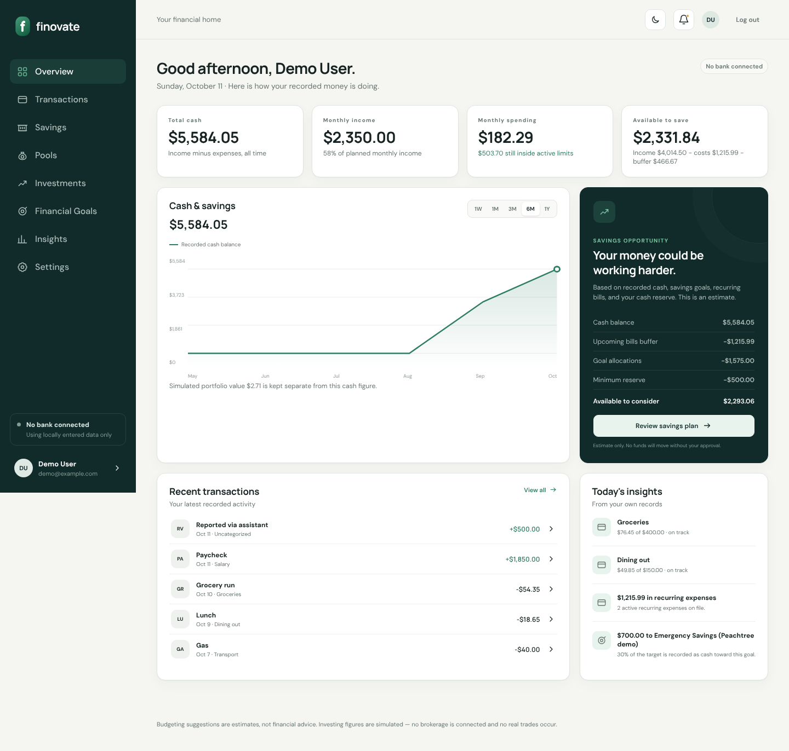
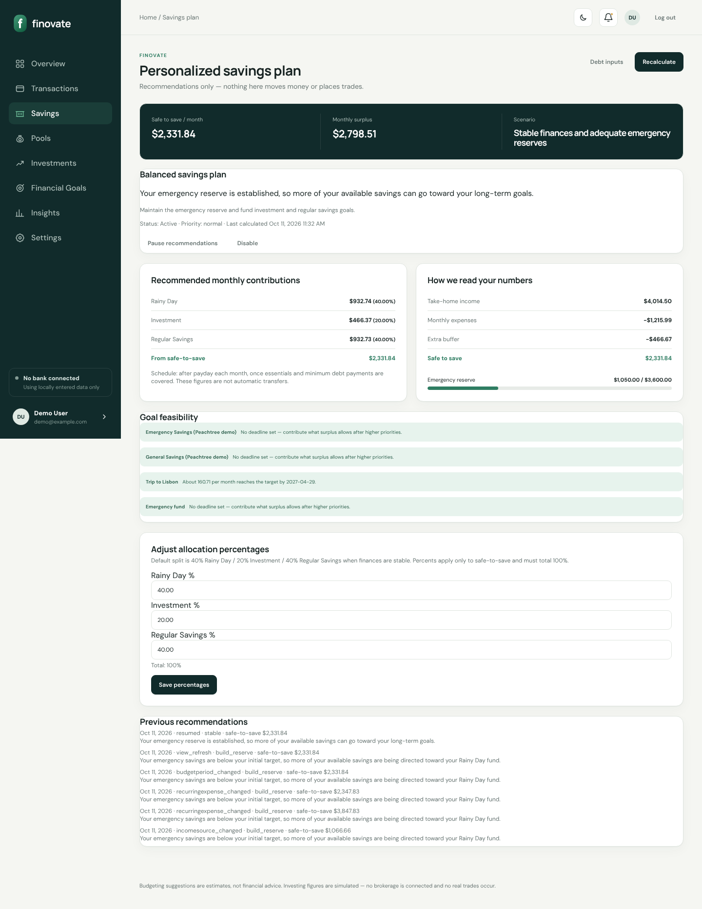
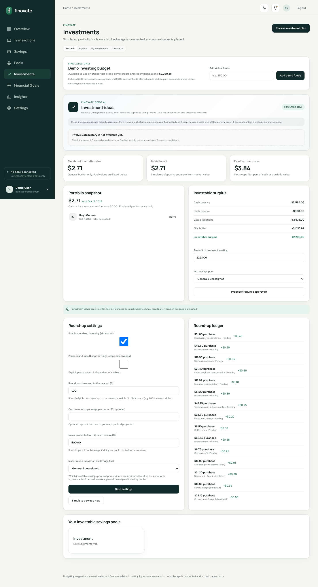
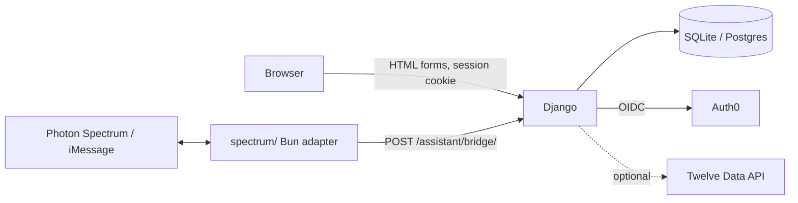

<p align="center"></p>

# Finovate

**Make your money move — and always know why.**
A Python personal-finance assistant for budgeting, savings goals, round-ups, and clearly labeled simulated investing, with a confirmation-gated iMessage-compatible chat interface.

| | |
|---|---|
| **Hackathon** | Hacklanta 2026 |
| **Team** | Turn It Off and On Again: Harold Aghedo (captain), Micheal White |
| **Live site** | https://finovate.biz |
| **Repository** | https://github.com/Simerr4life/Finovate |
| **Main track** | Fintech |
| **Side challenges** | MLH: Best Use of Auth0 · Photon: Agents in iMessage · MLH: Best Domain Name from GoDaddy Registry (`finovate.biz`). Evidence: [THIRD_PARTY_SERVICES.md](docs/THIRD_PARTY_SERVICES.md) |
| **Submission package** | [docs/SUBMISSION.md](docs/SUBMISSION.md) |

> **Status legend used across the docs:** ✅ verified · 🟡 implemented, not fully tested · 🟠 partial · 🧪 simulated / sample data · 📝 planned · ⛔ blocked on credentials or configuration.

---

## The problem

Budgets live in one app, savings goals in a spreadsheet, and investing in a brokerage that never talks to either. People end up guessing how much is actually "spare," and automated money tools rarely explain what they did or ask before they do it.

## What Finovate does

Finovate gives every dollar a labeled purpose and keeps the user in control:

- **Budget from real numbers** — enter transactions by hand or import a bank CSV (with duplicate detection), set income, bills, and category limits, and see live progress. ✅
- **A savings plan that explains itself** — a rule-based engine picks one of five scenarios (stabilization → strong capacity), splits a *safe-to-save* amount across Rainy Day, Investment, and Regular Savings pools, and shows every assumption. ✅
- **Goals with milestones** — targets, deadlines, 25/50/75/100% milestones, required pace, and projected completion. ✅
- **Round-ups, honestly** — a $4.35 purchase rounds up $0.65 into a *pending* ledger entry; nothing is "invested" until a simulated sweep respects your cash reserve and cap. ✅ 🧪
- **Simulated investing with guardrails** — proposals require explicit approval, cash vs. invested principal vs. market value are never merged, and every screen says "simulated." 🧪
- **Chat that asks before it acts** — "I got paid $500" → *"Record $500 as income today?"* → "yes". Money-changing intents always require confirmation; withdrawals are refused. ✅ (in-process) · 🟡 live iMessage delivery not verified

**What's not real:** no bank feed, no brokerage, no money movement. Investing is simulated; live market data needs a Twelve Data key. Full list: [docs/KNOWN_LIMITATIONS.md](docs/KNOWN_LIMITATIONS.md).

## Who it's for

Students and early-career earners with irregular income who want one place to see cash, plan savings, and learn investing without risking real money — and anyone who wants automation they can audit.

## What makes it different

1. **Separated money categories.** Cash balance, goal allocations, pending round-ups, invested principal, and market value are separate numbers everywhere (dashboard, investing, chat replies).
2. **Explainable engine, no black box.** The savings plan, surplus estimate, and demo investment ideas are deterministic rules with their assumptions printed on the page.
3. **Consent before change.** Website orders need an Approve click; chat changes need a "yes"; a paused plan stays paused.
4. **One brain, two interfaces.** The chat assistant calls the same service functions as the website, so both always agree.

## Screenshots

| Dashboard | Savings plan | Investing (simulated) |
|---|---|---|
|  |  |  |

All screenshots are real captures of this codebase running locally with seeded **sample data**. Catalog: [docs/SCREENSHOT_CATALOG.md](docs/SCREENSHOT_CATALOG.md).

## Technology (verified from the code)

| Layer | What's used |
|---|---|
| Language / framework | Python 3.13, Django 6.1 (server-rendered templates, no SPA) |
| Data | SQLite locally; PostgreSQL (e.g. Supabase) via `DATABASE_URL` / `SUPABASE_DB_URL`; all money in `Decimal` |
| Identity | Auth0 via `auth0-server-python` (Universal Login, encrypted cookie session, API token validation with Authlib); optional Supabase email/password sign-in |
| Messaging | Photon Spectrum: signed webhook endpoint in Django + a Bun/TypeScript adapter (`spectrum/`, `spectrum-ts`) |
| Market data | Twelve Data REST API (optional, server-side, quota-limited cache) |
| Front end | Hand-written CSS (`static/css/finovate.css`, Google Fonts), vanilla JS; light/dark themes |
| Deployment | Vercel (`vercel.json`), live at **https://finovate.biz** (`.biz` domain from GoDaddy Registry) |

Architecture: [docs/TECHNICAL_ARCHITECTURE.md](docs/TECHNICAL_ARCHITECTURE.md).



## Run it locally

```bash
python -m venv .venv && source .venv/bin/activate   # Windows: .venv\Scripts\activate
pip install -r requirements.txt
python manage.py migrate
python manage.py seed_demo                 # sample user "demo" with labeled demo data
python manage.py seed_peachtree_demo       # optional: fictional statement with reconciliation
python manage.py runserver
```

Open `http://127.0.0.1:8000/`, or use the live site at https://finovate.biz.

**Signing in:** website login requires Auth0 (`AUTH0_DOMAIN`, `AUTH0_CLIENT_ID`, `AUTH0_CLIENT_SECRET`, `AUTH0_SECRET`) or Supabase email sign-in (`SUPABASE_URL`, `SUPABASE_PUBLISHABLE_KEY`). With neither set, the login page says *"Sign-in isn't configured on this server."* — this is deliberate; there is no local password login. For a local walkthrough without providers, see the judge options in [docs/USER_GUIDE.md](docs/USER_GUIDE.md#1-getting-access).

**Try the assistant without Photon:**

```bash
python manage.py chat_demo --username demo
```

### Environment variables (names only)

Nothing is required to start. Copy `.env.example` to `.env` to enable features.

| Purpose | Variables |
|---|---|
| Core | `FINOVATE_SECRET_KEY`, `FINOVATE_DEBUG`, `FINOVATE_ALLOWED_HOSTS`, `FINOVATE_DB_PATH`, `FINOVATE_LOG_LEVEL`, `DEMO_ACCOUNT_PASSWORD` |
| Auth0 | `AUTH0_DOMAIN`, `AUTH0_CLIENT_ID`, `AUTH0_CLIENT_SECRET`, `AUTH0_SECRET`, `AUTH0_AUDIENCE`, `AUTH0_MGMT_CLIENT_ID`, `AUTH0_MGMT_CLIENT_SECRET`, `AUTH0_ACTION_SECRET`, `APP_BASE_URL` |
| Database / Supabase | `DATABASE_URL`, `SUPABASE_DB_URL`, `SUPABASE_URL`, `SUPABASE_PUBLISHABLE_KEY`, `SUPABASE_SECRET_KEY` |
| Photon Spectrum | `IMESSAGE_PROJECT_ID`, `IMESSAGE_PROJECT_SECRET`, `IMESSAGE_WEBHOOK_SECRET`, `PHOTON_WEBHOOK_SECRET` (legacy), `ASSISTANT_BRIDGE_SECRET` |
| Market data | `TWELVE_DATA_API_KEY` |
| Reserved, unused | `BANK_PROVIDER_API_KEY`, `BROKERAGE_PROVIDER_API_KEY`, `MESSAGING_PROVIDER_API_KEY` |

The adapter in `spectrum/` reads `PROJECT_ID`, `PROJECT_SECRET`, `FINOVATE_URL`, `ASSISTANT_BRIDGE_SECRET`, `SPECTRUM_PROVIDERS`.

### Database

`python manage.py migrate` creates the schema on SQLite or Postgres (31 app models across 8 Django apps). Migrations also load a 109-row bundled market-data sample; no current page displays it, because Explore, holdings, demo ideas, and the price-based scenario read Twelve Data rows only (the manual "what if" calculator works without any market data). On Vercel, `finovate/wsgi.py` runs `migrate` at boot and seeds the demo user only if `DEMO_ACCOUNT_PASSWORD` is set.

## Tests

```bash
python manage.py test        # 381 tests, all passing on 2026-10-11 (≈97 s)
```

Coverage includes the $4.35 → $0.65 round-up, Decimal precision, idempotent imports and duplicate detection, budget/plan recalculation, goal milestones and locking, order double-approval, Auth0 callback/verification/webhook handling, Spectrum signature checks, chat confirmations, and cross-user isolation. Details and manual validation: [docs/TESTING_AND_VALIDATION.md](docs/TESTING_AND_VALIDATION.md).

## Documentation map

| Document | For |
|---|---|
| [SUBMISSION.md](docs/SUBMISSION.md) | Copy-ready submission text |
| [HACKATHON_REQUIREMENTS.md](docs/HACKATHON_REQUIREMENTS.md) | Compliance checklist against the official Hacker Guide ([rules excerpt](docs/reference/hacker-guide-excerpt.md)) |
| [JUDGE_READINESS.md](docs/JUDGE_READINESS.md) | Criteria mapping, likely questions |
| [DEMO_SCRIPT.md](docs/DEMO_SCRIPT.md) · [DEMO_CHECKLIST.md](docs/DEMO_CHECKLIST.md) | Presenting |
| [USER_GUIDE.md](docs/USER_GUIDE.md) | Judges and first-time users |
| [PRODUCT_SPECIFICATION.md](docs/PRODUCT_SPECIFICATION.md) | Intended vs. implemented product |
| [TECHNICAL_ARCHITECTURE.md](docs/TECHNICAL_ARCHITECTURE.md) · [FEATURE_REFERENCE.md](docs/FEATURE_REFERENCE.md) | Engineers |
| [SECURITY_AND_PRIVACY.md](docs/SECURITY_AND_PRIVACY.md) | Security posture and gaps |
| [TESTING_AND_VALIDATION.md](docs/TESTING_AND_VALIDATION.md) | Evidence |
| [THIRD_PARTY_SERVICES.md](docs/THIRD_PARTY_SERVICES.md) | Auth0, Photon Spectrum, GoDaddy Registry domain, others |
| [KNOWN_LIMITATIONS.md](docs/KNOWN_LIMITATIONS.md) | Gaps and blockers |
| [SCREENSHOT_CATALOG.md](docs/SCREENSHOT_CATALOG.md) | Image index |
| [glossary.md](docs/glossary.md) · [docs/README.md](docs/README.md) | Earlier reference documentation |

## Known limitations (short)

No bank or brokerage connection; investing and order fills are simulated. Live prices, the Explore tab, and demo investment ideas need `TWELVE_DATA_API_KEY`. Notifications are recorded in-app but not delivered by email/SMS. Local website sign-in needs Auth0 or Supabase credentials (the live site at finovate.biz is configured). Live iMessage delivery was not verified during documentation. See [docs/KNOWN_LIMITATIONS.md](docs/KNOWN_LIMITATIONS.md).

## Disclosure (per the Hacker Guide)

Built during Hacklanta 2026 (all commits dated October 10–11, 2026). Existing work we built on: a **Figma Make** layout export (`.figma-make-inspect/`), open-source libraries (Django, auth0-server-python, Authlib, psycopg, python-dotenv, spectrum-ts), third-party APIs and services (Auth0, Photon Spectrum, Twelve Data, Supabase, Vercel, Google Fonts), and a bundled September 2026 market-data sample (`demo_data/`). AI coding assistants (Cursor, Claude Code) were used during development.

## Team and attribution

Built by team **Turn It Off and On Again** for Hacklanta 2026: **Harold Aghedo** (captain) and **Micheal White**. Third-party libraries and services are listed in [docs/THIRD_PARTY_SERVICES.md](docs/THIRD_PARTY_SERVICES.md). Development used AI coding assistants; see [SUBMISSION.md](docs/SUBMISSION.md#responsible-ai-and-financial-safety).

## Financial disclaimer

Finovate is a hackathon prototype for education and demonstration. It is not financial, investment, tax, or legal advice. Budget and savings figures are estimates. All investing features are simulated: no brokerage is connected, no securities are bought or sold, and no money moves. Investments can lose value, and past performance does not predict future results.
