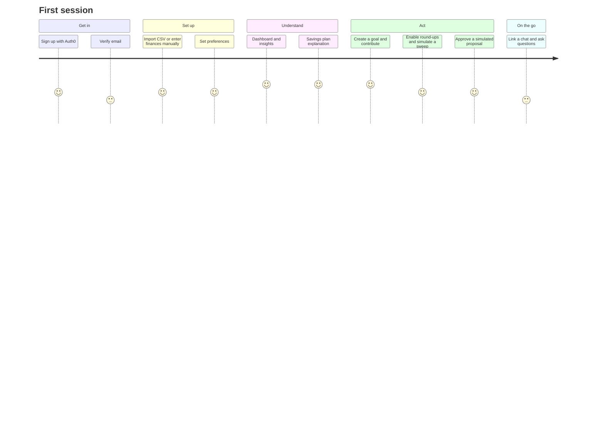

# Product Specification — Finovate

**Version:** Hacklanta 2026 submission · **Updated:** 2026-10-11
This specification combines the team's product direction with what the code actually does. The **Status** column is authoritative for current behavior; the rest describes intent. Formulas live in [FEATURE_REFERENCE.md](FEATURE_REFERENCE.md).

Status legend: ✅ verified · 🟡 implemented, not fully tested · 🟠 partial · 🧪 simulated · 📝 planned · ⛔ blocked.

## 1. Vision and principles

**Vision:** a personal finance assistant that helps people understand their money, build realistic budgets, reach savings goals, and learn investing safely, through a website and a messaging interface backed by one shared brain.

**Headline:** *Make Your Money Move.* Supporting copy: *Budget smarter, save consistently, and understand your investments with a financial assistant built around your goals.*

**Principles (and how the product enforces them):**

1. **Every dollar has a purpose:** cash, goal allocations, pending round-ups, invested principal, and market value are never merged.
2. **Every automated action is explainable:** plan scenarios, surplus breakdowns, and demo ideas print their inputs and assumptions.
3. **The user stays in control:** proposals wait for Approve; chat changes wait for "yes"; pause means paused.
4. **Honesty over polish:** simulated features say so; missing providers show clear "not configured / not available" states.

## 2. Users and use cases

| Persona | Need | Key use cases |
|---|---|---|
| Student / early-career earner with irregular income | Know what's safe to spend and save | Manual setup, budget limits, irregular-income buffer, Rainy Day pool |
| Saver with specific goals | Hit a target by a date | Goals with pace, milestones, projections |
| Curious first-time investor | Learn without risking money | Round-ups, simulated orders, calculator, disclosures |
| Busy user | Quick answers by text | "How's my budget", "I got paid $500", "pause round-ups" |

## 3. User journey

## 4. Functional requirements

| ID | Requirement | Status | Notes |
|---|---|---|---|
| FR-1 | Landing page with product overview | ✅ | `/` |
| FR-2 | Register, log in, log out through a secure identity provider | 🟡 | Auth0 (+ optional Supabase); live tenant not exercised in docs prep |
| FR-3 | Email verification before financial data is accessible | 🟡 | Auth0 accounts gated; Management API refresh |
| FR-4 | Password recovery | 🟡 | Provider-hosted (Auth0/Supabase); no in-app screen |
| FR-5 | Financial onboarding (income, expenses, savings, reserve, risk, preferences) | ✅ | Manual setup + preferences |
| FR-6 | Consent for connected financial services | 📝 | No financial services connected; messaging consent captured |
| FR-7 | Demo / sample-data mode | 🟠 | `seed_demo`, `seed_peachtree_demo`; demo rows flagged `is_demo` but not labeled in the UI |
| FR-8 | Dashboard: cash, income, spending, budgets, recent transactions, goals, investing summary | ✅ | |
| FR-9 | Data freshness / sync status | 🟠 | "No bank connected — using locally entered data only"; plan shows "Last calculated"; snapshots dated |
| FR-10 | Income sources with frequency; recurring bills; debts | ✅ | |
| FR-11 | Categories and per-category limits with warnings | ✅ | Visual warnings only |
| FR-12 | Manual and imported transactions | ✅ | CSV only |
| FR-13 | Automatic categorization; recurring-payment detection | 📝 | |
| FR-14 | Available-to-spend / safe-to-save estimate with explanation | ✅ | Safe-to-save and investable surplus |
| FR-15 | Recalculation when financial inputs change | ✅ | Signals after commit |
| FR-16 | Multiple goals with targets and dates | ✅ | |
| FR-17 | Contributions and progress, milestones 25/50/75/100% | ✅ | |
| FR-18 | Projected completion dates | ✅ | 90-day pace; dated-goal required pace |
| FR-19 | Edit goals; pause/archive goals | 🟠 | Edit ✅; pause/archive 📝 |
| FR-20 | Distinguish cash, planned allocations, invested assets | ✅ | |
| FR-21 | Portfolio summary and history | 🧪 | Simulated snapshots; Twelve Data history ⛔ without a key |
| FR-22 | Supported ETF information | 🟠 | Supported symbols are 5 US stocks via Twelve Data (no ETFs); bundled sample not displayed |
| FR-23 | Contributions and withdrawals | 🧪 | Buy orders; sell type exists in the model but no UI |
| FR-24 | Round-up calculation, eligibility, pending state | ✅ 🧪 | Sweep simulated |
| FR-25 | Order states pending / filled / rejected / cancelled | 🧪 | "Submitted", "executed", "failed" not modeled |
| FR-26 | Risk disclosures | ✅ | Every investing page and the footer |
| FR-27 | Contribution caps, cash reserve, pause controls | ✅ | |
| FR-28 | Weekly summaries | 📝 | |
| FR-29 | Unusual spending alerts, upcoming obligations | 📝 / 🟠 | Bills buffer only |
| FR-30 | Notifications for important states | 🟠 | Recorded, not delivered |
| FR-31 | Natural-language questions by message | ✅ | Regex intents |
| FR-32 | Update goals / record income by message | ✅ | With confirmation |
| FR-33 | Pause automation by message | ✅ | Round-ups |
| FR-34 | Confirmation for material changes; duplicate-message protection | ✅ | |
| FR-35 | Live iMessage delivery | 🟡 | Adapter implemented; not exercised |
| FR-36 | Profile, theme, accessibility basics | ✅ | Light/dark, skip link, focus styles, ARIA labels |
| FR-37 | Data export, account deletion | 🟠 | Transactions CSV export only |

## 5. Non-functional requirements

| Area | Target | Current |
|---|---|---|
| Money precision | Decimal, cent-quantized, half-up | ✅ |
| Isolation | No cross-user access | ✅ tested |
| Idempotency | Imports, round-ups, chat deliveries | ✅ |
| Responsiveness | Usable at 390 px | ✅ no horizontal scroll on tested pages |
| Performance | Demo scale | 🟠 no pagination |
| Availability | Deployed demo | ⛔ unverified |
| Privacy | Minimal data, no credentials | ✅ / gaps in [SECURITY_AND_PRIVACY.md](SECURITY_AND_PRIVACY.md) |

## 6. Page-by-page

| Page | Route | Purpose | Status |
|---|---|---|---|
| Landing | `/` | Introduce Finovate; Log in / Get started | ✅ |
| Sign up / Log in | `/accounts/signup/`, `/accounts/login/` | Auth0 (recommended), optional email | 🟡 |
| Verify | `/accounts/verify/` | Email verification gate | 🟡 |
| Onboarding | `/accounts/onboarding/`, `…/preferences/` | Data source + preferences | ✅ |
| Manual setup | `/accounts/manual-setup/` (+ summary) | Quick income/expense estimate | ✅ |
| Overview | `/dashboard/` | Money at a glance | ✅ |
| Transactions | `/budgets/transactions/` (+ add/edit/delete/export) | Ledger | ✅ |
| Budgeting | `/budgets/` | Income, bills, categories, periods, limits, plan | ✅ |
| Statements | `/statements/`, `/statements/<id>/` | Running balance, reconciliation | ✅ |
| Imports | `/imports/…` | CSV wizard and history | ✅ |
| Savings | `/savings/` | Savings overview | ✅ |
| Savings plan | `/savings/plan/` | Scenario plan and controls | ✅ |
| Debts | `/savings/debts/` | Debt inputs for the plan | ✅ |
| Pools / Goals | `/savings/pools/`, `/savings/goals/`, `/savings/<id>/` | Goals, pace, contributions | ✅ |
| Investments | `/investing/` (4 tabs) | Round-ups, simulated orders, explore, calculator | 🧪 / ⛔ Explore |
| Market data / What-if | `/investing/market-data/`, `/investing/historical-demo/` | Price history, hypothetical scenario | ⛔ without a key (manual what-if ✅) |
| Insights | `/insights/` | Trends | ✅ |
| Settings | `/accounts/settings/` | Preferences, messaging, history | ✅ |

## 7. Business rules (summary)

1. Transaction amounts are positive; `kind` sets the sign.
2. Round-up = next multiple of `round_to` minus amount; one per purchase; only expenses that aren't reversals, only while enabled and not paused.
3. Sweeps never exceed the pending total, the cap, or cash above the reserve.
4. Investable surplus protects the reserve, goal cash, and one month of bills.
5. Proposals are capped by uncommitted surplus and stay pending until approved.
6. Savings plan allocations never exceed safe-to-save; stabilization allocates nothing.
7. Plan status changes only through explicit user actions.
8. Default pools always exist and cannot be deleted.
9. Withdrawals from goals cannot exceed the balance.
10. Identity is keyed by provider ID, never by email.
11. Chat never moves money; changes require "yes".

## 8. Error states and edge cases

Empty states on every list; unreadable CSV → fallback page; partial import rows flagged; zero income → stabilization or "not enough data"; no active budget period → prompt to create one; Twelve Data missing or over quota → "not available" plus cached values; provider outages → user-safe messages; duplicate submissions → client-side single-submit guard and server-side idempotency and locks; expired session → re-login with `next` preserved.

## 9. MVP boundary

**In the MVP (built):** everything marked ✅ or 🧪 above.
**Explicitly out of scope:** real money movement, bank aggregation, brokerage execution, tax advice, multi-currency.

## 10. Roadmap (not implemented)

1. Read-only bank aggregation with explicit consent.
2. Notification delivery (email/push/iMessage outbound) and weekly summaries.
3. Auto-categorization and recurring-payment detection.
4. Goal pause/archive; budget period rollover.
5. Account deletion and data export.
6. A brokerage partner behind the existing pending → approve flow, with per-order consent and limits.
