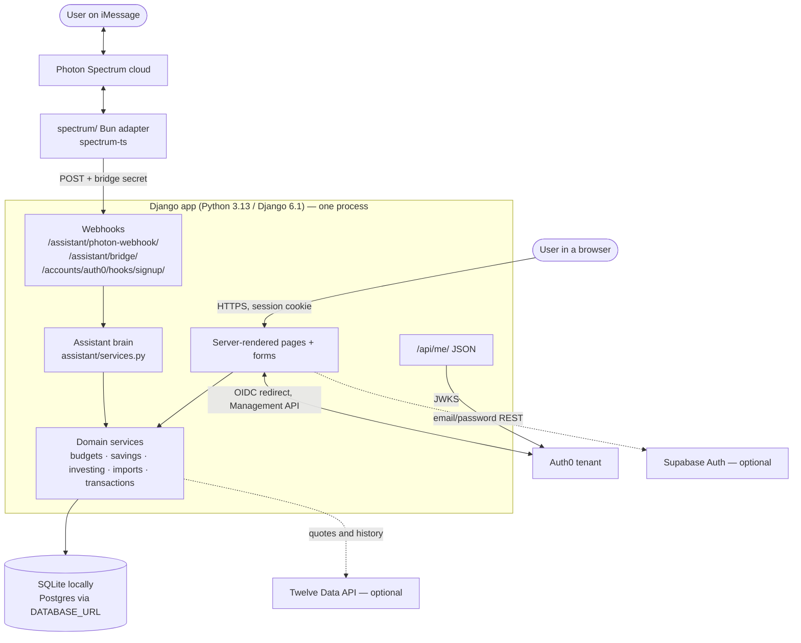
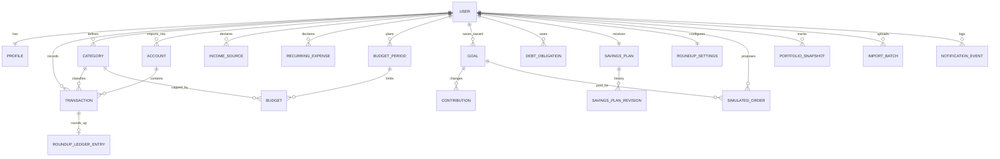
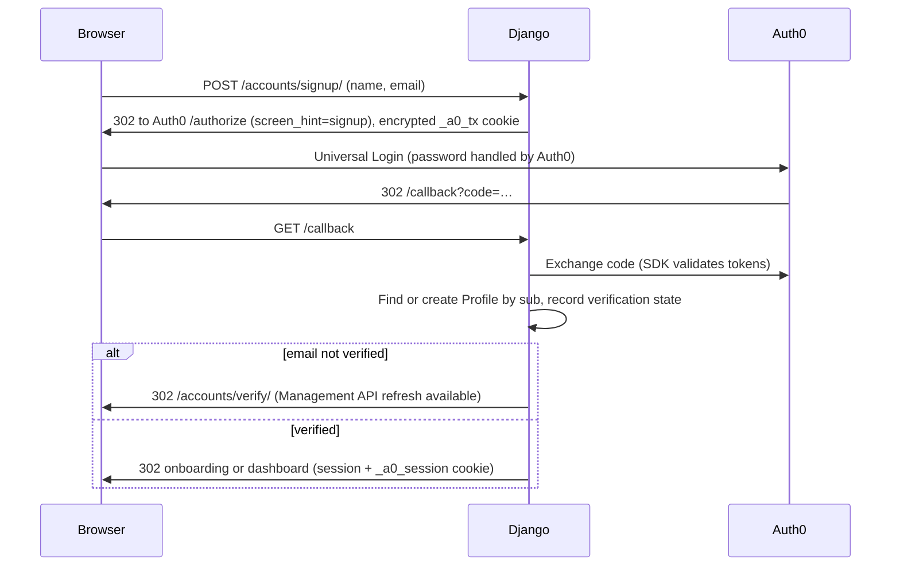
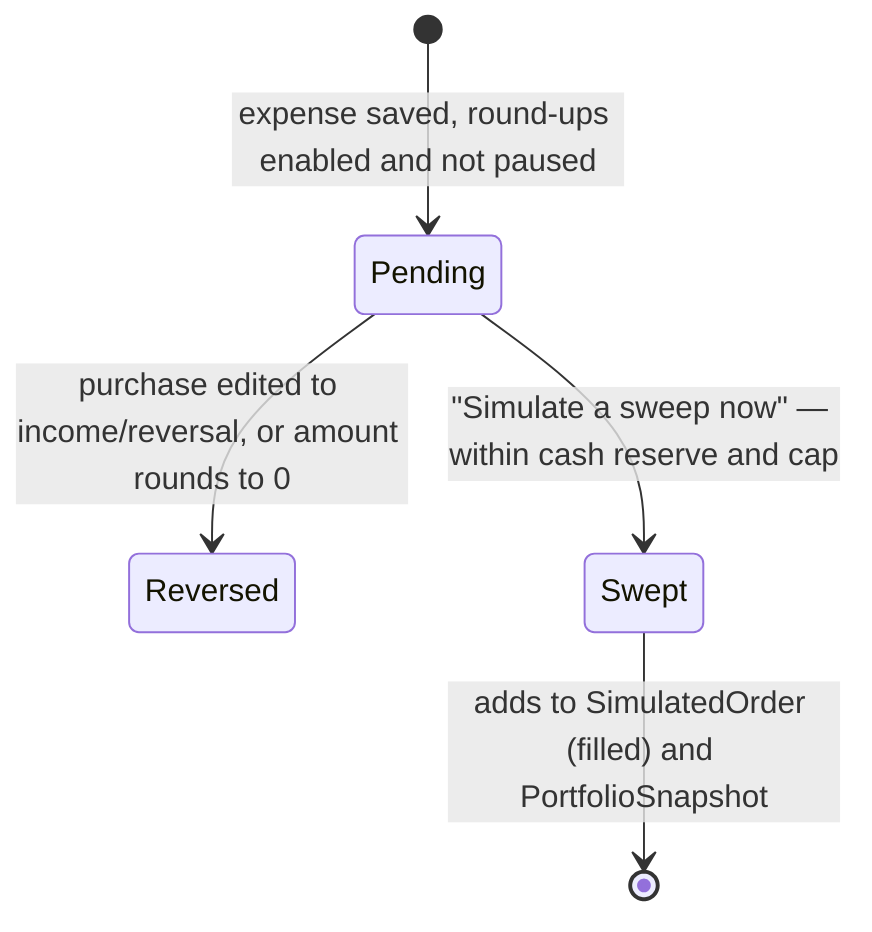
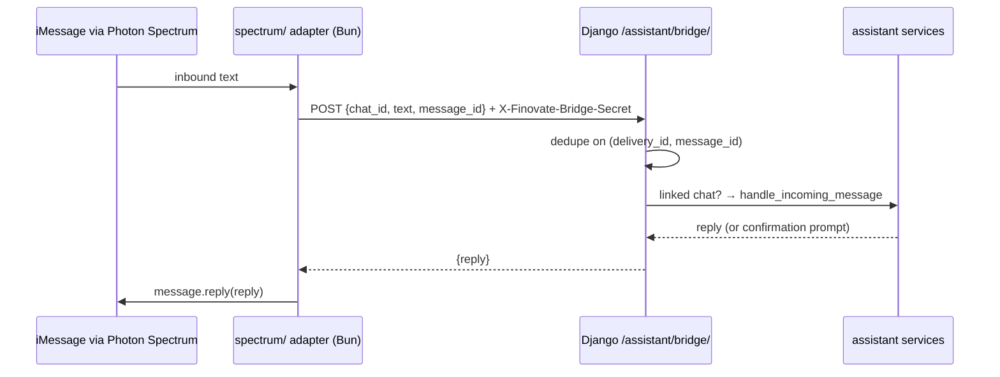
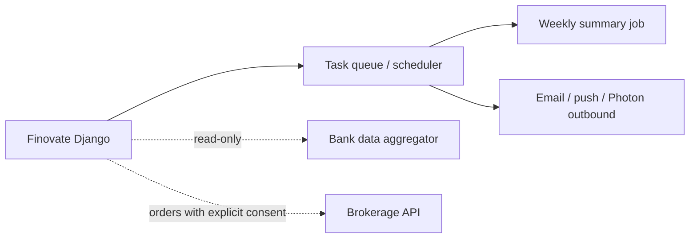

# Technical Architecture

**Describes:** the code as it exists on 2026-10-11 (branch `claude/codebase-audit-fixes`). A proposed future design is shown at the end and labeled as proposed.

## 1. System context

Solid lines are implemented and exercised by tests. Dotted lines are implemented but optional (off without credentials). There is **no** bank, brokerage, email, or SMS provider.

## 2. Components

| Django app | Responsibility | Key modules |
|---|---|---|
| `core` | Landing, dashboard, insights, money helpers, chart helpers, template filters, seed commands | `views.py`, `services.py` (`quantize_money`, `round_up_to_nearest`), `display.py`, `context_processors.py` |
| `accounts` | Profile, Auth0/Supabase identity, verification, onboarding, manual setup, settings, notification log, signup backup | `auth0.py`, `identity.py`, `middleware.py`, `verification.py`, `supabase_auth.py`, `auth0_backup.py`, `tokens.py`, `api.py`, `manual_setup.py` |
| `transactions` | Accounts (statement containers), categories, transactions, running balances, reconciliation | `models.py`, `services.py` |
| `budgets` | Income sources, recurring expenses, periods, category limits, plan math, transactions UI | `services.py`, `views.py`, `forms.py` |
| `savings` | Goals/pools, contributions, debts, personalized savings plan engine | `plan_engine.py`, `services.py`, `signals.py` |
| `investing` | Round-up settings and ledger, simulated orders, portfolio snapshots, demo funds/ideas, Twelve Data cache | `services.py`, `signals.py`, `live_quotes.py` |
| `imports` | CSV upload → account → review → commit | `pipeline.py`, `csv_enhanced.py`, `views.py` |
| `assistant` | Intent parsing, confirmations, chat linking, Spectrum transports | `intents.py`, `services.py`, `routing.py`, `linking.py`, `spectrum.py`, `views.py` |

The front end is Django templates (`templates/`) plus one stylesheet and small vanilla-JS files (`static/js/finovate.js`, market chart scripts). There is no SPA or build step. Browser ↔ server communication is HTML form posts with CSRF tokens, plus a few JSON endpoints: theme/name updates and live quotes.

Views stay thin and call service functions. The assistant calls the **same** services, so the website and chat cannot disagree.

## 3. Data model (core entities)

31 models in total. Important constraints:

- `Transaction.amount` is always positive; `kind` (income/expense) carries the sign. Unique `(user, source, external_id)` when `external_id` is set, which makes imports idempotent.
- `RoundUpLedgerEntry.source_transaction` is one-to-one: one round-up per purchase.
- `Goal (user, system_key)` is unique for the three engine pools.
- `Profile.auth0_sub` and `Profile.supabase_uid` are unique. **Accounts are never merged by email.**
- All money is `DecimalField(max_digits=12, decimal_places=2)` and is quantized half-up to cents (`core/services.py`).

## 4. Authentication and authorization

- **Session:** Django session (8 h, HTTP-only, `SameSite=Lax`, `Secure` when the base URL is HTTPS) plus the encrypted Auth0 state cookie. `Auth0SessionMiddleware` refreshes the access token 60 s before expiry and logs the user out if refresh fails. Unverified Auth0 users are confined to `/accounts/verify…` and logout.
- **Authorization:** every view that touches user data is `@login_required`. The public endpoints are the landing page, login/signup, `/accounts/verify/result/`, the three webhook endpoints (secret- or signature-authenticated), and `/api/me/` (token-authenticated). Every query filters on `user=request.user` or uses `get_object_or_404(..., user=request.user)`. Isolation tests cover goals, manual estimates, chat, and the API.
- **API:** `/api/me/` accepts only an RS256 access token for `AUTH0_AUDIENCE` (JWKS cached 10 min); the session cookie is not accepted.
- **Supabase** (optional) signs in by REST and maps by Supabase user ID.

## 5. Money flows

### Transactions → budgets → plan

1. Transactions arrive from manual entry (`/budgets/transactions/add/`), CSV import (`imports/pipeline.py`), the assistant ("I got paid…"), or seed commands.
2. A `post_save` signal (`investing/signals.py`) creates a **pending** round-up for each new eligible expense, and updates or reverses it when the purchase is edited.
3. Changes to income sources, recurring expenses, budgets, periods, or debts trigger `refresh_savings_plan` **after the database commit** (`savings/signals.py`). Revisions and notifications are recorded only for material changes (≥ $25 or ≥ 5%, or a scenario change).

### Round-up lifecycle (simulated)

Sweeps lock `RoundUpSettings` so concurrent sweeps run in series. Market value after a sweep equals contributions (no simulated drift).

### Investment proposals (simulated)

Propose → `SimulatedOrder(status=pending)` → Approve or Reject. Approval locks the order row, refuses anything not pending, then updates the pool/general `PortfolioSnapshot`. Proposals are capped at `max_surplus_proposal(user)`, so pending and filled orders use up the surplus.

## 6. Messaging

The alternative `/assistant/photon-webhook/` path verifies Spectrum HMAC signatures and returns the reply in JSON without sending (`delivered: false`).

## 7. Background jobs, notifications, retries

- **No scheduler or worker.** Work happens in-request or in `transaction.on_commit` callbacks. Management commands: `seed_demo`, `seed_peachtree_demo`, `seed_market_data`, `seed_excel_demo_market`, `reconcile_auth0_backups` (retries failed signup-backup rows), `chat_demo`.
- **Notifications:** `NotificationEvent` rows (account created, welcome, goal milestone, round-ups paused, savings plan, system). Shown in Settings; never sent externally.
- **Retries and idempotency:** Auth0 profile creation retries username collisions; signup backups retry via the command; Twelve Data uses leases plus a 5-minute retry delay; imports and bridge deliveries are idempotent; failed imports are marked `failed` and can be retried.

## 8. Errors, logging, monitoring

- Form errors render inline or as flash messages. Provider failures show user-safe messages (`SupabaseAuthError`, Twelve Data "not available", verification "unavailable").
- Logging is structured console output (`level=… logger=…`). The code comments forbid logging amounts or account details, and log calls record events and codes only.
- There is no external monitoring (Sentry, Datadog, etc.).

## 9. Deployment

| Aspect | Local | Vercel (`vercel.json`) |
|---|---|---|
| Entry | `manage.py runserver` | `finovate/wsgi.py` (60 s max) |
| Debug | On | Off unless `FINOVATE_DEBUG` |
| Hosts | `localhost`, `127.0.0.1` | `.vercel.app`, `finovate.biz`, `www.finovate.biz` |
| Database | `db.sqlite3` | `/tmp/finovate.sqlite3` (ephemeral) unless `DATABASE_URL` |
| Boot | — | `migrate`; seed `demo` if `DEMO_ACCOUNT_PASSWORD` set |
| Static | `runserver` serves `static/` | Vercel Django preset (not verified here) |

Production health could not be verified from this environment (see [KNOWN_LIMITATIONS.md](KNOWN_LIMITATIONS.md)). Environment variables are listed in the [README](../README.md#environment-variables-names-only).

## 10. Security boundaries

Browser ↔ Django (CSRF, session), Django ↔ Auth0 (server-side secret, encrypted cookies), adapter ↔ Django (shared bridge secret, constant-time compare), Photon ↔ Django (HMAC signature, 5-minute replay window), Auth0 Action ↔ Django (shared secret). Detail and gaps: [SECURITY_AND_PRIVACY.md](SECURITY_AND_PRIVACY.md).

## 11. Technical debt

- `auth0-server-python` beta; `authlib.jose` deprecated.
- `LocMemCache` for rate limits and JWKS/token caches (per process).
- Bundled market sample loaded but unused by views; redundant calculator code in `finovate.js`.
- Dashboard and context processor recompute surplus and plan on each request (fine at demo scale).
- No pagination; no scheduled jobs; signup backup stored in the same database it backs up.

## 12. Proposed (not implemented) architecture

> **Proposed only.** Nothing in this diagram beyond the existing Django app is built.

