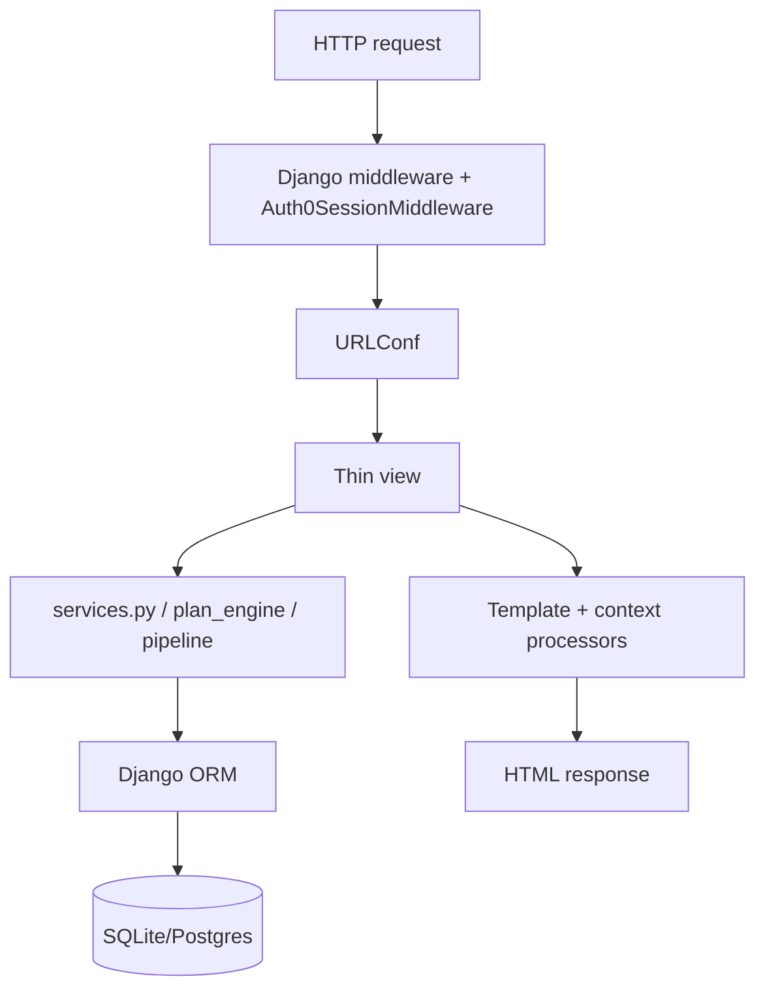
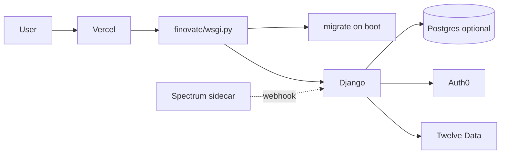

# Architecture

**Last reviewed:** 2026-10-11

## Request flow

## Design invariants

1. **Decimal money only** — `core.services`
2. **Business logic in services** — reusable by web + assistant
3. **Per-user ownership** on every query
4. **Simulated vs real labeled** in investing UI
5. **IdP owns passwords** — Finovate stores subjects/uids

## Deployment architecture

On Vercel: `VERCEL` enables hosts/SSL/tmp SQLite unless Postgres URL set; optional `seed_demo` when `DEMO_ACCOUNT_PASSWORD` set and no demo user.
