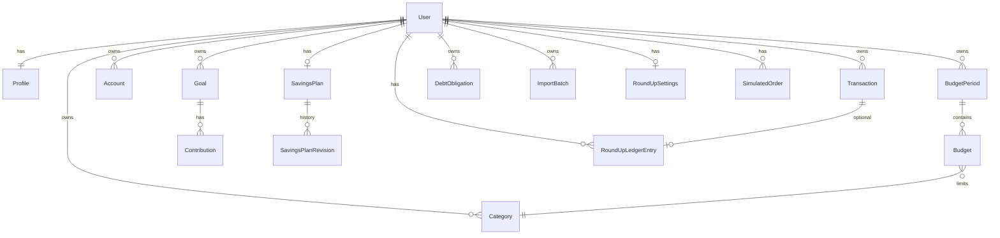

# Database reference

**Last reviewed:** 2026-10-11

Default: SQLite (`db.sqlite3` local; `/tmp/finovate.sqlite3` on Vercel). Optional Postgres via `DATABASE_URL` / `SUPABASE_DB_URL`.

## ER overview

## Core tables (fields summarized)

### Profile (`accounts_profile`)
Preferences, theme, notification toggles, `auth0_sub`, `supabase_uid`, identity/verification flags, messaging fields, manual setup amounts, `onboarding_completed`.

### NotificationEvent / ConnectedAccountPlaceholder
Event log; integration placeholders.

### Account / Category / Transaction (`transactions_*`)
Statement metadata; categories income/expense; transactions with optional account/category, `external_id` uniqueness, `source` manual|imported|demo.

### Budgets
IncomeSource, RecurringExpense, BudgetPeriod, Budget (unique period+category).

### Savings
Goal (incl. system_key / investable flags), Contribution, DebtObligation, SavingsPlan, SavingsPlanRevision.

### Investing
DemoInvestmentFunding, LiveMarketQuote, TwelveDataUsageWindow, TwelveDataHistoryState, RoundUpSettings, RoundUpLedgerEntry, PortfolioSnapshot, SimulatedOrder, DemoInvestmentSuggestion, MarketPrice.

### Imports
ImportBatch — raw file, status draft|committed|failed|discarded, mapping, counters.

### Assistant
PendingConfirmation, SpectrumDelivery, MessagingLinkCode, ConversationMessage.

## Migrations

Per-app under `*/migrations/`. Apply with `python manage.py migrate`.

## Retention / deletion

- User-owned rows cascade with user/FKs as modeled
- Import delete may remove file bytes while keeping committed transactions (see imports views)
- No automated TTL job in-repo
