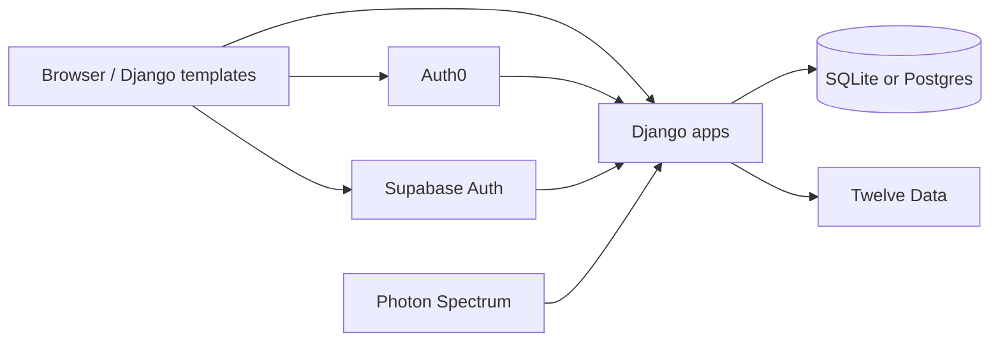

# Product overview

**Last reviewed:** 2026-10-11

## Purpose

Finovate helps individuals understand recorded cash flow, plan a budget, save toward goals, receive a **recommendation-only** savings plan, and explore a **simulated** investing experience — without requiring a live bank or brokerage connection.

## Capabilities (verified)

| Area | Capability | Real vs simulated |
|---|---|---|
| Transactions | Manual CRUD, search, CSV export | Real (local DB) |
| Imports | CSV bank-statement upload → preview → commit | Real |
| Statements | Demo/fictional ledger + reconciliation | Demo data |
| Budgets | Periods, category limits, progress, income/expenses | Real math on recorded data |
| Savings goals | Goals, contributions, milestones, pace | Real |
| Savings plan | Scenario engine, allocations, debts | Recommendation only |
| Investing | Round-ups, surplus propose/approve, demo AI, market explore | Simulated |
| Insights / dashboard | Charts, MoM, category breakdown | Derived from recorded data |
| Auth | Auth0 OIDC + optional Supabase email/password | External IdP |
| Messaging assistant | Keyword intents via Photon Spectrum webhook | Inbound verified; outbound not from Django |

## System overview

## Apps

| Django app | Owns |
|---|---|
| `core` | Landing, dashboard, insights, money helpers, seeds |
| `accounts` | Profile, Auth0/Supabase, onboarding, settings, `/api/me/` |
| `transactions` | Account, Category, Transaction, statements |
| `budgets` | Budget periods/limits, income, recurring expenses, txn UI |
| `savings` | Goals, contributions, pools, plan engine, debts |
| `investing` | Round-ups, simulated orders, market data, Twelve Data |
| `imports` | CSV import batches |
| `assistant` | Spectrum webhook, intents, link codes |

## Intended users

- Individuals tracking personal finances locally or on hosted Postgres
- Developers extending Finovate
- Operators deploying to Vercel with Auth0/Supabase

## Non-goals (current product)

- Real brokerage order routing
- Live bank aggregation
- Production notification delivery (email/push/SMS)
- Outbound iMessage from the Django process
